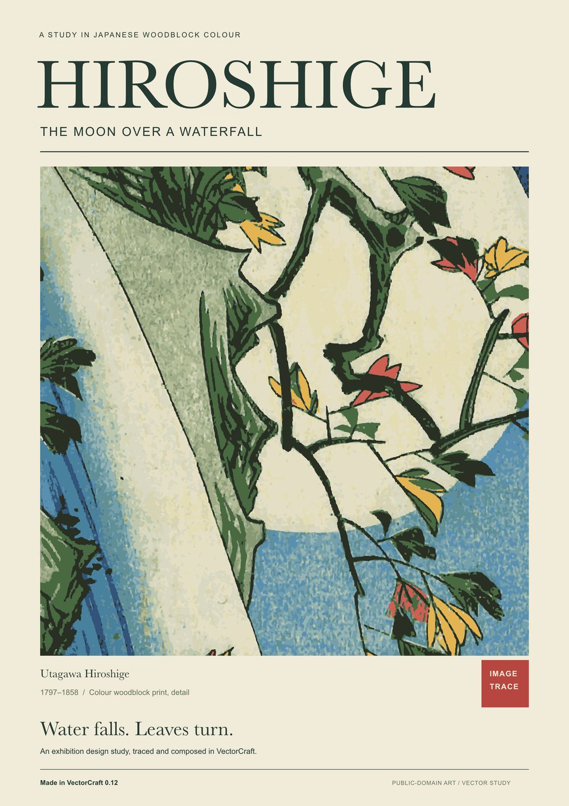
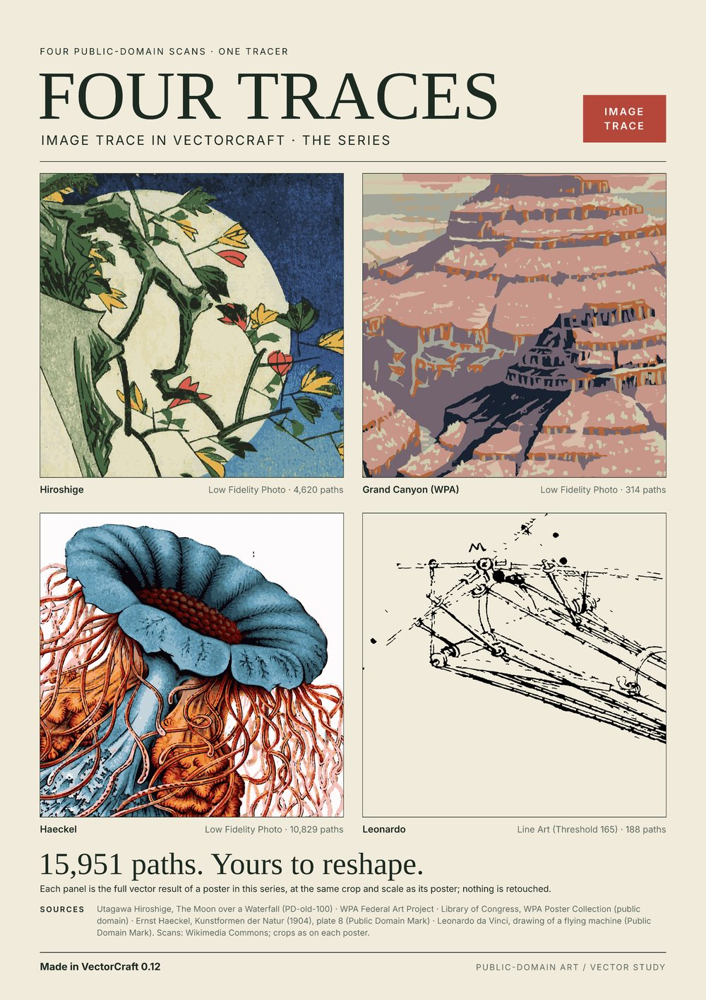

# Made in VectorCraft: Image Trace studies

Made with **VectorCraft 0.12.0** (main at `8bc65329`), release build, through VectorCraft's own
command API and renderer. Every image here is a downscaled VectorCraft render.
These are historical results, not a benchmark of current main. In this version the photo presets
used Limited palettes; their Colors captions describe a colour count, not the later Full Tone
colour-detail proposal. The JPEGs have not been regenerated for that proposal.

## Hiroshige exhibition poster

A design study after Utagawa Hiroshige's *The Moon over a Waterfall* (public domain). It invents
no exhibition dates or venue. The artwork was traced with the **Low Fidelity Photo** preset:
Color mode, Colors 20 (18 used), Paths 60, Corners 50, Noise 12, Overlapping. The trace has
3,908 paths and 162,439 anchors. It keeps the red and yellow leaves and covers the image more
evenly than the abutting 16 Colors result. The print's grain becomes posterized patches and thin
branches soften. This is a trace interpretation, not a facsimile. The layout and editable type
were made with VectorCraft commands. The fonts are referenced by name, not included.

## Trace posters

Four public-domain images, each traced once in VectorCraft and laid out with VectorCraft commands.
Each poster shows the raster input beside the vector result at the same crop and scale, then
one detail three ways: the real pixels enlarged nearest-neighbour, the traced colour shapes, and
the actual path outlines. The path counts are the ones VectorCraft reported, and the traced
artwork is not retouched.

| Poster | Preset and settings | Paths |
|---|---|---:|
| [Grand Canyon (WPA poster designed by C. Don Powell, ca. 1938)](posters/wpa-poster.jpg) | Low Fidelity Photo: Color, Colors 20 (10 used), Paths 60, Corners 50, Noise 12, Overlapping | 314 |
| [Hiroshige](posters/hiroshige-poster.jpg) | Low Fidelity Photo: Colors 20 (18 used), otherwise as above | 4,620 |
| [Haeckel](posters/haeckel-poster.jpg) | Low Fidelity Photo: Colors 20 (20 used), otherwise as above | 10,829 |
| [Leonardo](posters/leonardo-poster.jpg) | Line Art with Threshold 165: Black and White, Ignore White, Paths 80, Corners 70, Noise 10, Abutting | 188 |

Known limitations, visible on the posters:
- **Grand Canyon:** thin pale bands follow some shadow and cliff edges, from the scan's soft edges.
- **Hiroshige:** the paper grain becomes flecks, and the finest twigs thicken or break.
- **Haeckel:** pale pink halos follow the tentacles, and the plate number breaks up.
- **Leonardo:** most light hatching is lost or dashed, and the ink blots fill solid.

## Settings sheets

Each sheet shows the source first, then one trace per preset. Each trace is captioned with its
preset, Mode, Colors, Paths, Corners, Noise, Method, and the path and anchor counts VectorCraft
reported.

| Sheet | Presets shown |
|---|---|
| [Hiroshige, waterfall and leaves](hiroshige-presets.jpg) | 6 Colors, 16 Colors, Low Fidelity Photo, Shades of Gray |
| [Gray's Anatomy, leg detail](gray-leg-presets.jpg) | Default, Line Art, Technical Drawing, Sketched Art, Black and White Logo |
| [Cat face](a01-cat-face-presets.jpg) | Default, Auto Color, 3 Colors, 6 Colors, Flat Logo, Black and White Logo, Outline |
| [Apple](f01-apple-presets.jpg) | as above |
| [Cherries](f02-cherries-presets.jpg) | as above |
| [Waves](s02-waves-presets.jpg) | as above |
| [Star badge](g02-star-badge-presets.jpg) | as above |
| [Colour junctions](c05-junctions-presets.jpg) | as above |
| [Paths and Corners](paths-corners-settings.jpg) | Cat, 6 Colors base: Paths 0/50/100 × Corners 0/50/100 |
| [Noise](noise-settings.jpg) | Cat, 6 Colors base: Noise 1/16/50 |

[settings-and-counts.csv](settings-and-counts.csv) lists the settings and counts for every
trace. The paths are VectorCraft's traced components, including compound paths, and the anchors
include those of every subpath. [svg/](svg/) holds the 6 Colors trace of each logo as an example
of the exported vectors.

## Inputs and rights

[SOURCES.md](SOURCES.md) identifies all five exact scan files, their source-page rights statements,
SHA-256 hashes, and crops (including the four trace posters). [SHA256SUMS](SHA256SUMS) identifies
the shipped JPEG/SVG/CSV bytes. The original layouts are MIT OR Apache-2.0; their licence does
not relicense the underlying public-domain scans.

| Input | Source | Licence | Preparation |
|---|---|---|---|
| Six test logos (cat, apple, cherries, waves, star badge, colour junctions) | Drawn in code for VectorCraft testing | MIT OR Apache-2.0 | 768 × 768, anti-aliased |
| Hiroshige | [Utagawa Hiroshige, *The Moon over a Waterfall*](https://commons.wikimedia.org/wiki/File:Hiroshige,_The_moon_over_a_waterfall.jpg) | Public domain (PD-old-100) | Crop (left, top, right, bottom) [160, 350, 1184, 1374], 1024 × 1024 |
| Gray's Anatomy | [H. V. Carter, Gray's Anatomy (1918), fig. 259](https://commons.wikimedia.org/wiki/File:Gray259.png) | Public domain | Upper 367 × 367 square, resampled to 1024 × 1024 (the source is only 367 × 1000 pixels, so this adds no detail) |

## What to look for: known limitations

All traces were inspected at full resolution. Nothing was retouched or replaced.

- **Hiroshige:** 16 Colors shows small white crescents and a network of pale contours around the
  light waterfall texture. 6 Colors shows faint pale boundaries and loses the red and yellow.
  Low Fidelity Photo, which uses Overlapping, covers the image most evenly. Shades of Gray groups
  the texture into coarse grey masses.
- **Gray's Anatomy:** hatching and labels break up or disappear, and small type isn't reliably
  readable, especially in Sketched Art. The low-resolution source limits every result.
- **Logos:** with Abutting colour presets, fine pale lines can appear along some colour
  boundaries (for example the apple's leaf vein). Auto Color and 3 Colors merge some light or
  similar colours by design. The monochrome presets drop colours on the light side of their
  threshold. Outline shows small kinks on the cat's whiskers.
- **Noise:** Noise 1 gives 23 paths and 561 anchors. Noise 16 and 50 both give 17 paths and
  537 anchors, with identical renders.

The full-resolution sheets (about 6500 pixels wide), the poster as SVG and as a VectorCraft
document, and every trace SVG are not included here, to keep the repository small.
